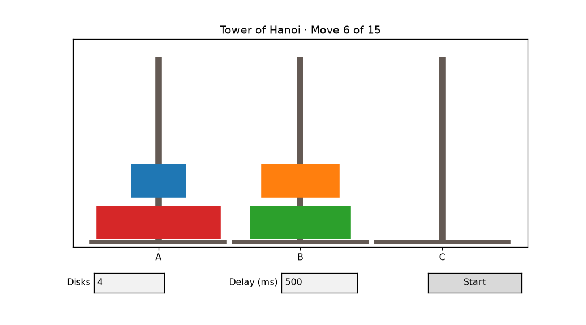

# Tower of Hanoi Visualizer

A recursive solver with a command-line interface and an interactive Matplotlib animation. Choose 1–10 disks, adjust the delay between moves, and replay the solution from the starting board.



## Install and run

With Python 3.10 or newer:

```bash
python -m pip install .
hanoi 3
```

You can also download the installable wheel from the [v0.1.0 release](https://github.com/Mikebourne7/hanoi-visualizer/releases/tag/v0.1.0) and pass the downloaded file to `python -m pip install`.

The CLI prints the seven moves for three disks. It runs with Python's standard library.

To open the animation on a machine with a graphical desktop:

```bash
python -m pip install '.[gui]'
hanoi 3 --gui
```

## How it works

The solver moves the top \(n-1\) disks to the spare peg, moves the largest disk to the target, and repeats the process from the spare peg. This takes \(2^n-1\) moves. The animation draws snapshots of the resulting board so repeated frames render the same state.

## Project history

This edition revisits an archived Matplotlib animation whose source file is dated October 2024. It adds an installable CLI, separates the solver from the animation, and verifies every move for all supported disk counts in CI.
